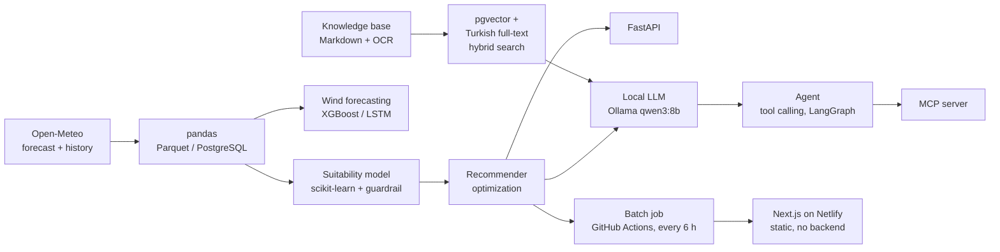

# SpotCast

**Is this spot good for windsurfing, at this hour, for my level?**
An end-to-end AI system that answers that question for the Turkish coast, from raw weather
data to a tool-calling LLM agent, with every part measured.

[](https://github.com/boraozisik/spotcast/actions/workflows/ci.yml)
[](https://github.com/boraozisik/spotcast/actions/workflows/publish.yml)

**Live demo:** _Netlify link coming soon_ (Turkish UI)

I built SpotCast step by step to learn AI engineering end to end: data, classical ML,
deep learning, LLMs, RAG, agents, evaluation and MLOps. Windsurfing at intermediate level is
the first vertical slice; sports and levels are configuration (an "activity profile"), not code.

## What it does

- **Forecast → verdict:** pulls wind and wave forecasts from Open-Meteo and labels every hour
  as good / marginal / bad with a scikit-learn model.
- **Guardrail:** hard safety rules sit on top of the model. The model once called a 40-knot storm
  "good" (it had never seen one); the guardrail makes that impossible.
- **Recommendations:** an optimizer picks the best spot and time window under the user's
  constraints (hours, weekend, minimum length).
- **Any place on the coast:** "Saturday in Mersin, is it OK?" works for places that are not
  curated spots, with clear warnings when there is no wave data or no local guide.
- **Explanations with sources (RAG):** a local LLM explains the recommendation in Turkish,
  citing spot guides and safety documents stored in pgvector.
- **Agent + MCP:** a tool-calling agent (hand-written loop and LangGraph) answers free-form
  questions; the same tools are exposed to other AI clients through an MCP server.
- **Evaluation:** retrieval quality, agent answers and an LLM judge are measured on fixed test
  sets. The measurements found real bugs.

## Architecture



**The public site has no backend.** A scheduled GitHub Actions job runs the same model,
guardrail and recommender every 6 hours and publishes JSON to the `site-data` branch; the
static Next.js site reads it in the browser. Nothing is exposed that could be abused, nothing
sleeps, nothing costs money (batch inference). The LLM parts run locally: free hosting cannot
run an 8B model at a usable speed, so the site shows real recorded agent conversations.

## Results that changed my mind

**Retrieval** (18 questions with known answers, top 3):

| Step | hit@1 | hit@3 | MRR |
|---|---|---|---|
| Baseline (vector search) | 72% | 78% | 0.74 |
| Content fix (split mixed sections by topic) | 83% | 94% | 0.87 |
| Hybrid search, first version | 78% | 94% | 0.85 ↓ |
| Hybrid + common-word filter (IDF-like) | 83% | 94% | 0.88 |
| + Query expansion (knots → Beaufort, in code) | **89%** | **100%** | **0.94** |

My guess was that hybrid search would help most. Measured, the content fix did; the first
hybrid version made things worse (PostgreSQL's ranking ignores how common a word is).

**LLM judge** (10 hand-labelled answer/source pairs): a single verdict agreed with the labels
80% (contradictions) / 70% (added advice). Splitting the answer into claims and letting code
decide: 100% / 100%.

**Agent answers** (10 scenarios with frozen tool results, each run 3 times): 8/10 at first.
The evaluation found the agent turning "yarın" (tomorrow) into the wrong date 3 times out of 3;
after the fix, 30/30 runs pass.

**Wind in 48 hours** (MAE, knots, test year 2025): persistence 2.91, climatology 2.46,
XGBoost 2.43, LSTM 2.40. All models hit the same information limit; a horizon experiment
(1 h: 0.69 → 48 h: 2.43) shows why.

## Principles I followed

- **Code computes, the LLM only words it.** Dates, comparisons and unit conversions are code.
- **A prompt rule is a request; a code rule is a guarantee.** The LLM once changed a beginner's
  level to "intermediate" despite the prompt; now the level is fixed in code and hidden from it.
- **Safety text never comes from the LLM.** Cautions, uncertainty notes and source quotes are
  fixed text added by code.
- **Measure, don't guess.** Every improvement is checked against a baseline.
- **Human in the loop.** New knowledge documents enter as drafts and reach search only after review.

## Tech stack

Python 3.12 · uv · pandas · scikit-learn · XGBoost · PyTorch · FastAPI · Pydantic ·
PostgreSQL + pgvector · Ollama (qwen3:8b, bge-m3, qwen2.5vl:7b) · LangGraph · MCP · MLflow ·
Docker · GitHub Actions · Next.js · TypeScript · Tailwind CSS · Netlify

## Repository layout

| Path | What |
|---|---|
| `src/spotcast/data.py`, `config.py`, `places.py` | Open-Meteo data, spots and coastal places |
| `src/spotcast/profiles.py`, `labels.py`, `model.py` | Activity profiles, labels, classifier, guardrail |
| `src/spotcast/forecasting.py`, `wind_model.py`, `lstm_model.py` | 48 h wind forecasting |
| `src/spotcast/recommend.py`, `api.py` | Optimizer and FastAPI service |
| `src/spotcast/llm.py`, `explain.py`, `rag.py` | LLM, explanations, hybrid retrieval |
| `src/spotcast/vision.py`, `ocr.py` | Sea photos → Beaufort, OCR of signs |
| `src/spotcast/tools.py`, `agent.py`, `agent_graph.py`, `mcp_server.py` | Tools, agents, MCP |
| `src/spotcast/evals/`, `evals/` | Evaluation code and test sets |
| `src/spotcast/tracking.py` | MLflow experiment tracking |
| `src/spotcast/publish.py` | Batch job behind the website |
| `knowledge/` | Spot guides, Beaufort scale, safety rules (RAG sources) |
| `web/` | Next.js website |
| `tests/` | 200+ tests (pytest, fakes only) |

## Run it locally

```bash
uv sync                                   # Python dependencies
cp .env.example .env                      # then set your own database password
docker compose up -d db                   # PostgreSQL + pgvector
uv run spotcast                           # history, labels, training (tracked in MLflow)
uv run spotcast-api                       # http://127.0.0.1:8000/docs
```

LLM features need [Ollama](https://ollama.com) with `qwen3:8b` and `bge-m3`:

```bash
uv run spotcast-index                     # build the knowledge index
uv run spotcast-agent "Cumartesi Mersin'de rüzgâr sörfü uygun mu?"
uv run spotcast-eval answers              # agent evaluation (uses the GPU for minutes)
```

Website with local data:

```bash
uv run spotcast-publish --out web/public/data
cd web && npm install && npm run dev
```

## Data and licenses

Weather and wave data: [Open-Meteo.com](https://open-meteo.com/), licensed
[CC BY 4.0](https://creativecommons.org/licenses/by/4.0/) (historical data from ERA5 /
Copernicus). Sample photos and signs used for the vision and OCR experiments are public
domain and are not part of this repository.

SpotCast is a learning project, not a safety service. Always check conditions on site.
