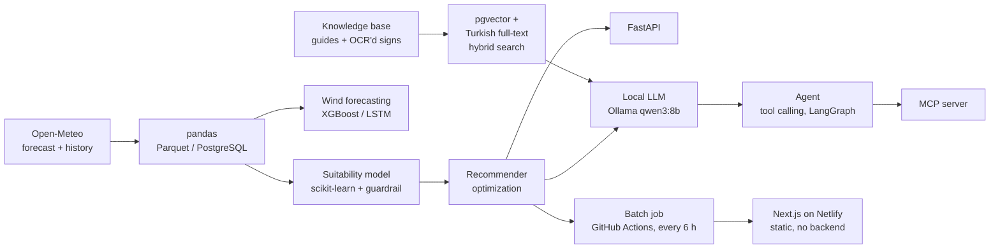

# SpotCast

**Is this spot right for my level, at this hour?**
SpotCast is an AI-powered windsurf forecasting system for the Turkish coast. It turns raw wind
and wave forecasts into clear, hour-by-hour verdicts and the best time windows to go, and
answers free-form questions through a tool-calling AI assistant.

[](https://github.com/boraozisik/spotcast/actions/workflows/ci.yml)
[](https://github.com/boraozisik/spotcast/actions/workflows/publish.yml)

**Live:** [spotcastai.netlify.app](https://spotcastai.netlify.app/) (English / Turkish)

## Features

- **Hour-by-hour verdicts.** Every forecast hour is labelled *good*, *marginal* or *not suitable*
  by a machine learning model, for a given sport and skill level.
- **Hard safety guardrails.** Safety rules sit on top of the model and can never be overridden:
  a storm is never "good", whatever the model predicts.
- **Best time windows.** An optimizer picks the best spot and session window under the user's
  constraints (hours, weekend, minimum session length).
- **Any point on the coast.** Places outside the curated spots are assessed with the same model and
  rules, with explicit warnings when there is no wave data or no local guide.
- **Explanations with sources.** A locally hosted LLM explains each recommendation in Turkish,
  citing spot guides and safety documents retrieved from a vector database.
- **AI assistant and MCP server.** A tool-calling agent answers questions such as "Is Saturday in
  Mersin OK for windsurfing?". The same tools are available to other AI clients through MCP.
- **Uncertainty notes.** Forecasts five or more days ahead and points without wave data are flagged
  automatically.
- **Continuously evaluated.** Retrieval quality, agent answers and an LLM judge are measured on
  fixed test sets.

Windsurfing at intermediate level is the first supported profile. Sports and levels are defined
as configuration ("activity profiles"), so new ones need no code changes.

## Architecture



**The public website has no backend.** A scheduled GitHub Actions job runs the model, guardrail
and recommender every six hours and publishes the results as JSON to the `site-data` branch. The
static Next.js site reads them in the browser. With no server, there is nothing to attack, nothing
to go down and nothing to pay for (batch inference). The LLM components run on a locally hosted
model; recorded assistant conversations are shown on the site.

## Evaluation highlights

**Retrieval** (18 questions with known answer sections, top 3):

| Change | hit@1 | hit@3 | MRR |
|---|---|---|---|
| Baseline (vector search) | 72% | 78% | 0.74 |
| Content restructured (mixed sections split by topic) | 83% | 94% | 0.87 |
| Hybrid search, first version | 78% | 94% | 0.85 ↓ |
| Hybrid + common-word filter (IDF-like) | 83% | 94% | 0.88 |
| + Query expansion (knots → Beaufort, in code) | **89%** | **100%** | **0.94** |

Restructuring the content had the largest impact. The first hybrid version reduced quality
because PostgreSQL's ranking ignores how common a word is; filtering common words fixed it.

**LLM judge** (10 hand-labelled answer/source pairs): a single verdict agreed with the labels in
80% (contradictions) and 70% (unsupported additions) of cases. Splitting answers into claims and
deciding in code: 100% / 100%.

**Agent answers** (10 scenarios with frozen tool results, each run 3 times): 8/10 on the first run.
The evaluation caught the agent mapping "yarın" (tomorrow) to the wrong date in 3 of 3 runs; after
the fix, 30/30 runs pass.

**48-hour wind forecasting** (MAE in knots, test year 2025): persistence 2.91, climatology 2.46,
XGBoost 2.43, LSTM 2.40. A horizon study (1 h: 0.69 → 48 h: 2.43) shows that the remaining error is
an information limit of local history, not a modelling limit.

## Design principles

- **Code computes, the LLM only words it.** Dates, comparisons and unit conversions are done in code.
- **Critical rules live in code, not in prompts.** The user's level is fixed by the system and
  hidden from the model; the model cannot change it.
- **Safety text never comes from the LLM.** Cautions, uncertainty notes and source quotes are fixed
  texts added by the system.
- **Measured, not assumed.** Every change is checked against a baseline on a fixed test set.
- **Human review.** New knowledge documents enter as drafts and become searchable only after review.

## Tech stack

Python 3.12 · uv · pandas · scikit-learn · XGBoost · PyTorch · FastAPI · Pydantic ·
PostgreSQL + pgvector · Ollama (qwen3:8b, bge-m3, qwen2.5vl:7b) · LangGraph · MCP · MLflow ·
Docker · GitHub Actions · Next.js · TypeScript · Tailwind CSS · Netlify

## Repository layout

| Path | Contents |
|---|---|
| `src/spotcast/data.py`, `config.py`, `places.py` | Open-Meteo data, spots and coastal places |
| `src/spotcast/profiles.py`, `labels.py`, `model.py` | Activity profiles, labels, classifier, guardrail |
| `src/spotcast/forecasting.py`, `wind_model.py`, `lstm_model.py` | 48-hour wind forecasting |
| `src/spotcast/recommend.py`, `api.py` | Optimizer and FastAPI service |
| `src/spotcast/llm.py`, `explain.py`, `rag.py` | LLM client, explanations, hybrid retrieval |
| `src/spotcast/vision.py`, `ocr.py` | Sea-state estimation from photos, OCR of signs |
| `src/spotcast/tools.py`, `agent.py`, `agent_graph.py`, `mcp_server.py` | Tools, agents, MCP server |
| `src/spotcast/evals/`, `evals/` | Evaluation code and test sets |
| `src/spotcast/tracking.py` | MLflow experiment tracking |
| `src/spotcast/publish.py` | Batch job behind the website |
| `knowledge/` | Spot guides, Beaufort scale, safety rules (RAG sources) |
| `web/` | Next.js website (EN/TR) |
| `tests/` | 200+ tests (pytest, no network or LLM needed) |

## Running locally

```bash
uv sync                                   # Python dependencies
cp .env.example .env                      # then set your own database password
docker compose up -d db                   # PostgreSQL + pgvector
uv run spotcast                           # history, labels, training (tracked in MLflow)
uv run spotcast-api                       # http://127.0.0.1:8000/docs
```

LLM features need [Ollama](https://ollama.com) with `qwen3:8b` and `bge-m3`:

```bash
uv run spotcast-index                     # build the knowledge index
uv run spotcast-agent "Cumartesi Mersin'de rüzgâr sörfü uygun mu?"
uv run spotcast-eval answers              # agent evaluation
```

Website with local data:

```bash
uv run spotcast-publish --out web/public/data
cd web && npm install && npm run dev
```

Tests and checks:

```bash
uv run pytest -q
uv run ruff check . && uv run ruff format --check .
```

## Data and licenses

Weather and wave data: [Open-Meteo.com](https://open-meteo.com/), licensed
[CC BY 4.0](https://creativecommons.org/licenses/by/4.0/) (historical data from ERA5 /
Copernicus). Photos and signs used in the vision and OCR experiments are public domain and are not
included in this repository.

SpotCast forecasts are guidance only. Always check the conditions on site before going out.
